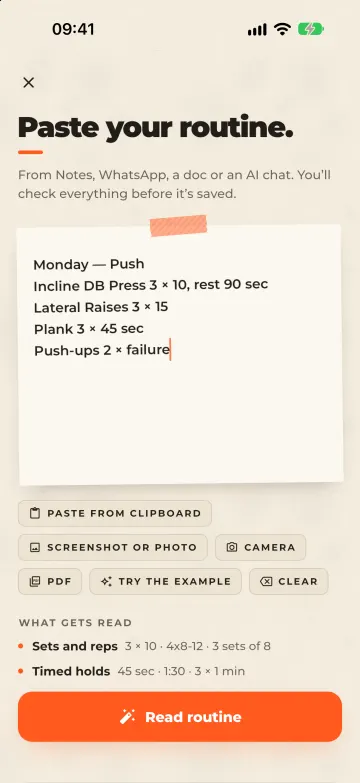
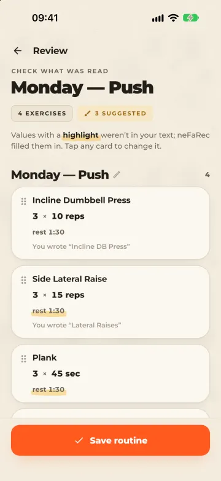
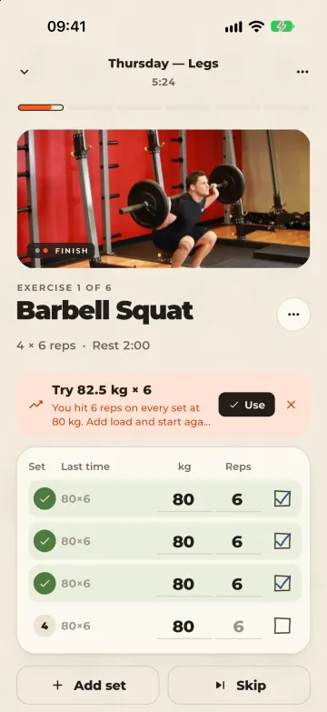
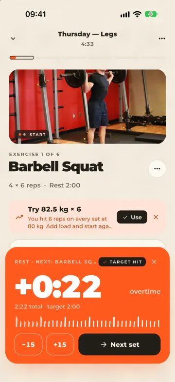
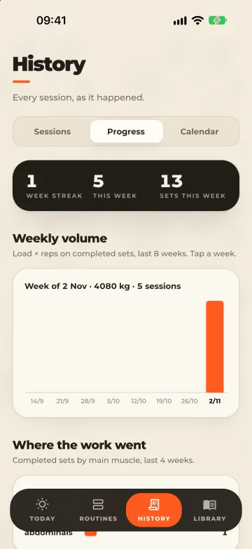

# neFaRec

**A workout app for messy routines. Paste yours in, train it, and check your form.**

Most people's routine lives in a WhatsApp chat, a note or a screenshot from their coach. Workout apps want it typed in again exercise by exercise, and nobody tells you whether your reps are any good. neFaRec takes the routine as it is: paste or screenshot it, check what it read, train it with a set table that remembers last time's numbers, and check your form live with the camera.

**[Download the Android APK](https://github.com/mofixiu/neFaRecmobile/releases/latest)** · [Watch the demo](https://github.com/mofixiu/neFaRecmobile/releases/latest) · [Tap through it in your browser](https://mofiyinebo.com)

### Try it in a minute

1. Install `neFaRec-1.6.0.apk` (Android 7+; allow installs from your browser when asked). If your phone says it isn't compatible, it runs 32-bit Android: use `neFaRec-1.6.0-older-phones.apk` instead.
2. Tap **Paste a routine**, then **Try the example**, or paste your own routine from WhatsApp.
3. Check the review screen, save, and start a workout. Log a few sets and finish to get the receipt.
4. New to the gym? In **Routines**, tap **New to the gym?** for a starter plan, or in **Library** tap **What’s this machine?** and photograph any machine.

No account, no internet needed. Everything stays on the phone.

<p>
  
  
  
  
  
</p>

*Paste · Review · Train · Rest · Progress.* You can tap through every screen at [mofiyinebo.com](https://mofiyinebo.com).

## What it does

- **Import a routine as text.** Paste it, or pick a photo, screenshot or PDF and the app reads the text on the phone (Apple Vision on iPhone, ML Kit on Android). The parser finds days, exercises, sets, rep ranges, timed holds and rest, and the review screen highlights every value it had to fill in so you can fix it before you save.
- **Train it.** Each set shows what you did last time. Rest is a scoreboard that counts into overtime, holds like planks get their own timer, and the rest timer carries on in the Dynamic Island and on the lock screen as a Live Activity.
- **See your history.** Each session ends as a receipt. History has weekly volume, a muscle split, trend charts for each lift and a training calendar.
- **Look up any move.** 884 exercises with steps and photos, 42 looping demo videos, and swaps for the equipment you have.
- **Check your form, live or from a video.** Point the camera at yourself and neFaRec counts and measures each rep as you do it, or film a set and check it after. It tracks your joints in every frame (Apple Vision on iPhone, ML Kit pose detection on Android). It counts reps and checks what matters for the lift: depth for squats, lunges and push-ups, body line for push-ups, hinge and lockout for deadlifts, lockout and lean for overhead presses, and range and swing for curls. It says when the clip isn't clear enough to judge.
- **Find out what a machine is.** New to the gym? Take a photo of any machine and neFaRec names it, then shows how to set it up, a beginner tip, the mistake to avoid and what to do on it, linked to the library. It reads the name printed on the machine when there is one, and otherwise shows its best guesses for you to pick from. It knows 27 kinds of equipment, from the leg press to the stair climber. The model runs on the phone (Core ML on iPhone, TensorFlow Lite on Android); see [Equipment model](#equipment-model).
- **Start from nothing.** No routine? Answer three questions (days a week, what your gym has, whether you've lifted before) and neFaRec builds a full-body or upper/lower starter plan from the library, which you check before saving. A first-visit guide covers what to bring, gym manners and what to say when you want a machine.
- **Get the weight right.** After each set, tap how it felt (easy, good, hard, too heavy) and neFaRec sets the weight for the rest of your sets, and for next time. A plate calculator shows what to load on each side of the bar, and "Machine taken?" swaps in an exercise for the same muscles on equipment that's free.
- **Works offline.** Everything is stored on the phone. An optional account backs your data up to the [neFaRec API](https://github.com/mofixiu/neFaRecbackend).

## Equipment model

The scanner is a MobileNetV3 image classifier, fine-tuned on about 2,400 photos of 27 kinds of gym equipment from the [Gym machines image dataset](https://huggingface.co/datasets/suc1dalspinach/Gym_machines_Image_dataset) on Hugging Face, after removing near-duplicates. The same model ships as TensorFlow Lite on Android and Core ML on iPhone (6 MB each). On a held-out set of 290 photos it names the right equipment first 65% of the time, and has it in its top three 85% of the time. The treadmill, bike, barbell, leg press, dip machines and preacher bench are reliable; lookalike seated machines (shoulder press, chest press, pec deck, seated row, leg curl against leg extension) get confused, which is why the app shows its runners-up and trusts a name printed on the machine over its own guess. The photos in the equipment guide are from free-exercise-db (public domain). The training photos are not in this repo or the app.

The parser is also published on its own as [workout_parser](https://pub.dev/packages/workout_parser), and you can [try it in your browser](https://workoutparse.mofiyinebo.com).

## Built with

| Area | Choice |
| --- | --- |
| App | Flutter and Dart, on iPhone and Android (the Live Activity is iPhone-only) |
| State | Riverpod |
| Storage | Drift (SQLite), with secure storage for the account token |
| Native iOS | SwiftUI and ActivityKit for the Live Activity; Vision and PDFKit for text recognition and body pose |
| Native Android | ML Kit text recognition and pose detection (bundled models), PdfRenderer and MediaCodec, in Kotlin behind the same channel |
| Look | [paper_kit](https://pub.dev/packages/paper_kit), my handmade-paper UI kit |
| Backend | [neFaRec API](https://github.com/mofixiu/neFaRecbackend): Node, TypeScript and PostgreSQL, only for accounts and backups |

Code is grouped by feature under `lib/features` (import, today, routines, workout, history, library, formcheck, account, settings), with shared services, models and the database in `lib/core`.

## Run it

```bash
flutter pub get
flutter run
```

The app works fully offline. The account and backup screens need the API: run it from the [backend repo](https://github.com/mofixiu/neFaRecbackend), which the simulator reaches at `127.0.0.1:4100`. For a real phone on your Wi-Fi:

```bash
flutter run --dart-define=NEFAREC_API=http://<your-computer-ip>:4100
```

## Tests

```bash
flutter analyze
flutter test
```

The tests cover the parser, the rest and hold timer, progression, analytics, the repositories and backups, and the form-check maths.

## Regenerating things

- **Database code**, after editing `lib/core/db/database.dart`: `dart run build_runner build --delete-conflicting-outputs`
- **App icon:** `flutter test tool/icon/render_icon_test.dart`, then `dart run flutter_launcher_icons`
- **Demo videos:** `python3 tool/videos/fetch_wger.py` (needs ffmpeg)
- **Sample history for screen recordings:** build with `--dart-define=NEFAREC_DEMO_SEED=true` on a fresh install to get a few weeks of made-up sessions. Never use it for a release build.

## Credits

The exercise library is built from [free-exercise-db](https://github.com/yuhonas/free-exercise-db) (public domain). The 42 demo clips come from [wger](https://wger.de) (CC BY-SA 4.0), trimmed to 10 seconds, and are credited in Settings → Video credits and on each video.
