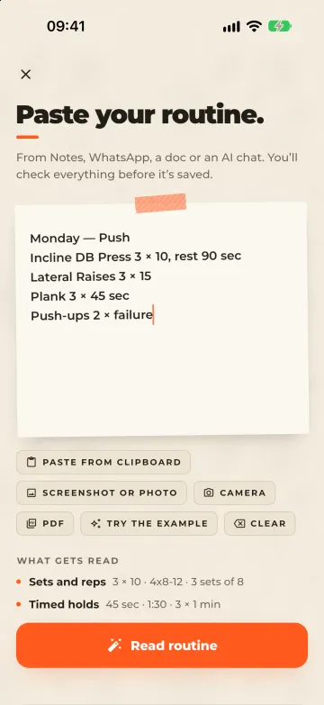
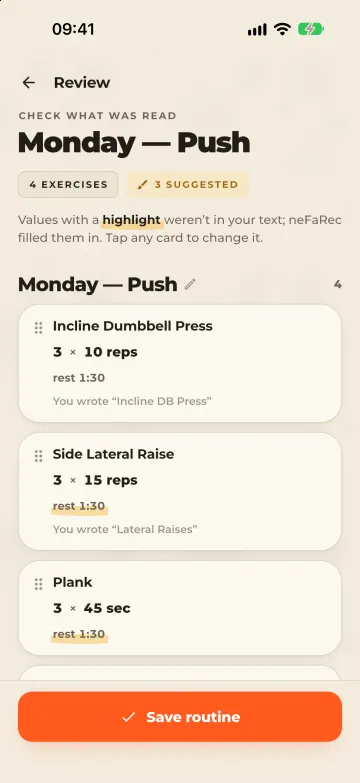
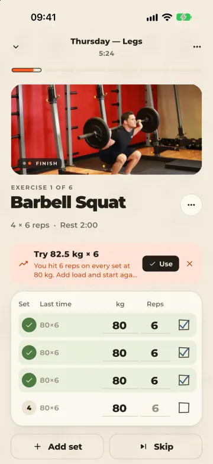
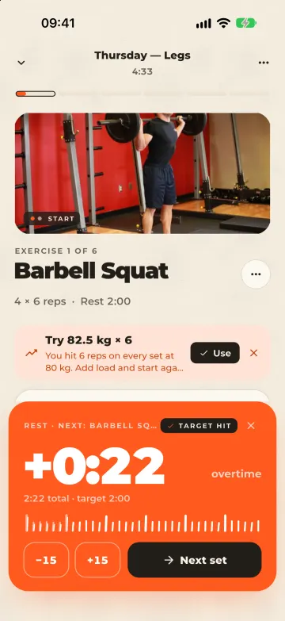
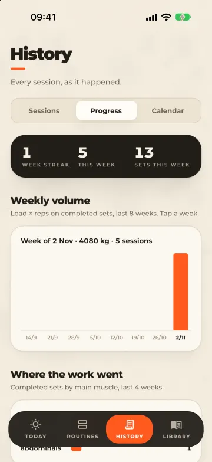

# neFaRec

A workout tracker that starts from the routine you already have. Most people's routine lives in a note, a WhatsApp message or an AI chat. You paste it in, check what neFaRec read, and train it with a set table that remembers last time's numbers.

<p>
  
  
  
  
  
</p>

*Paste · Review · Train · Rest · Progress.* You can tap through every screen at [mofiyinebo.com](https://mofiyinebo.com).

## What it does

- **Import a routine as text.** Paste it, or pick a photo or PDF and the app reads the text on the phone with Apple's Vision. The parser finds days, exercises, sets, rep ranges, timed holds and rest, and the review screen highlights every value it had to fill in so you can fix it before you save.
- **Train it.** Each set shows what you did last time. Rest is a scoreboard that counts into overtime, holds like planks get their own timer, and the rest timer carries on in the Dynamic Island and on the lock screen as a Live Activity.
- **See your history.** Each session ends as a receipt. History has weekly volume, a muscle split, trend charts for each lift and a training calendar.
- **Look up any move.** 884 exercises with steps and photos, 42 looping demo videos, and swaps for the equipment you have.
- **Check your squat.** An on-device form check reads a side-view clip with Vision body-pose detection and reports depth, knee angle and torso lean, and says when the clip isn't clear enough to judge.
- **Works offline.** Everything is stored on the phone. An optional account backs your data up to the [neFaRec API](https://github.com/mofixiu/neFaRecbackend).

The parser is also published on its own as [workout_parser](https://pub.dev/packages/workout_parser), and you can [try it in your browser](https://workoutparse.mofiyinebo.com).

## Built with

| Area | Choice |
| --- | --- |
| App | Flutter and Dart, iOS first (Android builds, but photo/PDF import and the form check are iPhone-only) |
| State | Riverpod |
| Storage | Drift (SQLite), with secure storage for the account token |
| Native iOS | SwiftUI and ActivityKit for the Live Activity; Vision and PDFKit for text recognition and body pose |
| Look | [paper_kit](https://pub.dev/packages/paper_kit), my handmade-paper UI kit |
| Backend | [neFaRec API](https://github.com/mofixiu/neFaRecbackend): Node, TypeScript and PostgreSQL, only for accounts and backups |

Code is grouped by feature under `lib/features` (import, today, routines, workout, history, library, formcheck, account, settings), with shared services, models and the database in `lib/core`.

## Run it

```bash
flutter pub get
flutter run
```

The app works fully offline. The account and backup screens need the API: run it from the [backend repo](https://github.com/mofixiu/neFaRecbackend), which the simulator reaches at `127.0.0.1:4100`. For a real phone on your Wi-Fi:

```bash
flutter run --dart-define=NEFAREC_API=http://<your-computer-ip>:4100
```

## Tests

```bash
flutter analyze
flutter test
```

The tests cover the parser, the rest and hold timer, progression, analytics, the repositories and backups, and the form-check maths.

## Regenerating things

- **Database code**, after editing `lib/core/db/database.dart`: `dart run build_runner build --delete-conflicting-outputs`
- **App icon:** `flutter test tool/icon/render_icon_test.dart`, then `dart run flutter_launcher_icons`
- **Demo videos:** `python3 tool/videos/fetch_wger.py` (needs ffmpeg)

## Credits

The exercise library is built from [free-exercise-db](https://github.com/yuhonas/free-exercise-db) (public domain). The 42 demo clips come from [wger](https://wger.de) (CC BY-SA 4.0), trimmed to 10 seconds, and are credited in Settings → Video credits and on each video.
